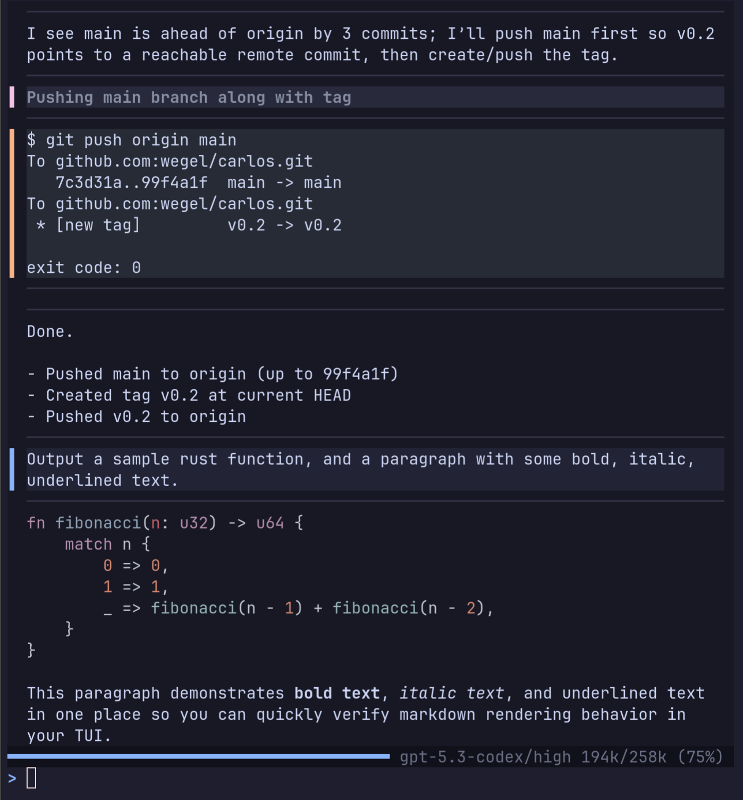

# carlos

Terminal frontend for `codex app-server`, the `claude` CLI, and `grok agent`.

[](docs/screenshot.png)

## status

Alpha.

## features

- start a new Codex thread with `carlos`
- start a new Claude session with `carlos --backend claude`
- start a new Grok session with `carlos --backend grok`
- resume Codex with `carlos resume <SESSION_ID>` or pick from `carlos resume`
- resume Claude with `carlos --backend claude resume <SESSION_ID>` or pick from `carlos --backend claude resume`
- resume Grok with `carlos --backend grok resume <SESSION_ID>` or pick from `carlos --backend grok resume`
- backend selection via `--backend <codex|claude|grok>` or `CARLOS_BACKEND=grok`
- feature-gated local voice dictation (`Ctrl+D`) with Whisper profiles selected by `--dictation-profile <name>`
- runtime Ralph mode toggle (`Ctrl+R`) with:
  - prompt auto-injection from `.agents/ralph-prompt.md` (or `--ralph-prompt`)
  - blocked marker wait state (`@@BLOCKED@@` by default)
  - human approval gate marker (`@@AWAITING_HUMAN@@` by default), which exits Ralph
    instead of preserving a paused loop
  - completion marker detection + auto-exit from Ralph mode (`@@COMPLETE@@` by default)
  - configurable done, blocked, and human-gate markers
- multiline input with `Shift+Enter` / `Alt+Enter`
- shell-like input history navigation with `Up/Down`
- rewind mode for prompt replay/edit (`Esc,Esc` on empty input)
- turn interrupt while agent is running (`Esc`)
- markdown rendering and code syntax highlighting
- diff rendering with hunk-oriented display
- compact tool/action rows (`Read`, `Search`, `Edit`, `Diff`, `run ...`)
- Ctrl+M settings and `/tools auto|compact|full` control tool contents, with Auto hiding them on small terminals
- mouse scroll and drag selection with auto-copy on release
- OSC52 clipboard support for SSH sessions
- context usage indicator (`used/max (%)`) on the activity line
- Ralph mode visual indicators (`RALPH MODE` label, pink KITT/input gutter)
- context compaction markers in transcript
- native Codex waits and child-agent start/completion notices, including notices after the main answer
- dim, right-aligned session-name placeholder in the empty composer; `/rename [name]` edits the saved Codex name

## Tool output on small terminals

Carlos keeps the tool output it receives in memory and lets you choose how much
to show. Open Ctrl+M, select **Tool output**, use the arrow keys, and press Enter
to save. Escape cancels unsaved edits. You can also enter `/tools auto`,
`/tools compact`, or `/tools full`. A bare `/tools`
cycles through the three choices. These commands stay inside Carlos and never
send a message to the agent.

- `auto` is the default. Carlos folds tool contents below 80 columns or 20
  rows. It unfolds them once the terminal has at least 84 columns and 22 rows,
  so small resize changes do not repeatedly fold and unfold the transcript.
- `compact` replaces tool contents with summaries, including short command
  results, multiline scripts, reads, diffs, and failure details. Failed tools
  keep a `Failed:` label. Full mode reveals their details. Assistant answers
  and approval prompts remain visible.
- `full` shows all received tool output, even on a small terminal.

The Ctrl+M panel shows the chosen mode and, in Auto, the current view. Carlos
saves your explicit choice in `~/.config/carlos/ui-settings.json` (or under
`XDG_CONFIG_HOME` when set). Auto's temporary choice for a phone-sized terminal
does not change that saved preference. You can reveal earlier output without
rerunning a tool; reopened sessions use the contents available in the backend's
saved history.

## RTK commands

Carlos recognizes `rtk`, `rtk proxy`, `rtk bypass`, and `rtk run -c` when it builds
tool summaries, including global flags, nested wrappers, and quoted paths. It
labels native `rtk read`, `rtk smart`, search commands, tests, and builds by what
they do. Full mode keeps the RTK command and its flags, including complete command
chains when the backend provides them.

Single-file `rtk read` and wrapped `cat`, `head`, `tail`, `nl`, and print-only `sed`
commands get source colors even when the backend cannot identify the file. RTK's
numbered `│` gutters remain visible. Carlos leaves multiple-file and transformed
outputs as received.

RTK may shorten output before Carlos receives it. Full mode shows that received
text, including any saved-log references RTK prints. See the
[RTK README](https://github.com/rtk-ai/rtk/blob/master/README.md) for its command
filters and wrappers.

## Session names

When the composer is empty, Carlos shows the saved session name in gray on the
right. The name is only a placeholder: typing hides it, clearing your draft brings it back, and
pressing Enter on an empty composer does not send the name as a message.

For Codex sessions, enter `/rename New name` to save a name, or enter `/rename`
to load the current name into the composer for editing. Carlos saves the name
through Codex's app-server, without starting an agent turn. The name survives
restarting Carlos and appears in the native Codex session picker too. Carlos also
shows name changes sent by Codex while the session is open. Unnamed sessions keep
the empty composer.

## Codex background monitors

Carlos uses the installed Codex app-server to run tools and child agents. Ask Codex
to monitor a task just as you would in the native Codex CLI. Carlos shows Codex's
waits and child-agent notices, and you can send another message while Codex waits.
An incoming message wakes Codex's interruptible `clock.sleep` tool. The same notices
remain visible when you reload the thread.

Codex can also launch an independent script through a shell or a remote process
manager. Such a script may keep running and writing logs, but Carlos cannot turn
those logs into agent messages by itself. Ask Codex to use its own child-agent or
wait tools when you need results in the conversation. Carlos does not add a timer
that sends prompts, create another agent turn when a child finishes, or promise
that a monitor will survive exiting Carlos.

## Ralph Loop Setup

If you want to run a repository in Ralph mode, this repo includes a generic starter bundle in
[`examples/ralph-loop/`](examples/ralph-loop/). That directory is laid out to mirror the root of
the target repository, so you can copy its contents verbatim into another repo and start from
there.

Copy the bundle into the target repo root with:

```bash
cp -r examples/ralph-loop/. /path/to/target-repo/
```

The bundle contains only files that belong at the target repo root or under `.agents/`:

- an example [`AGENTS.md`](examples/ralph-loop/AGENTS.md)
- an example [`PROGRAM_PLAN.md`](examples/ralph-loop/PROGRAM_PLAN.md)
- ExecPlan guidance in [`PLANS.md`](examples/ralph-loop/.agents/PLANS.md)
- a seed ExecPlan in [`EXECPLAN_001_example.md`](examples/ralph-loop/.agents/execplans/EXECPLAN_001_example.md)
- the Ralph prompt in [`ralph-prompt.md`](examples/ralph-loop/.agents/ralph-prompt.md)
- the current reviewer prompt directory: [`reviewers/`](examples/ralph-loop/.agents/reviewers/) with [`engineering_reviewer.md`](examples/ralph-loop/.agents/reviewers/engineering_reviewer.md)
- an empty `.agents/done/` directory placeholder for completed ExecPlans

The intended flow is:

1. Copy the contents of `examples/ralph-loop/` into the repository you want to automate.
2. Replace the example ExecPlan with a real one and update `PROGRAM_PLAN.md`.
3. Start `carlos` and press `Ctrl+R`, or launch with:

```bash
carlos --ralph-prompt .agents/ralph-prompt.md
```

`carlos` handles the continuation loop inside the TUI, watches for `@@BLOCKED@@` and
`@@COMPLETE@@`, and lets you answer blockers directly in the session.

## build

```bash
cargo build --release
cargo build --release --features dictation
```

The optional `dictation` Cargo feature enables in-process microphone capture, VAD, resampling,
and local Whisper inference. Builds without the feature do not link audio or Whisper dependencies.

## dictation

Build with:

```bash
cargo build --release --features dictation
```

Configure profiles in `~/.config/carlos/dictation.toml`:

```toml
default_profile = "fr-qc"

[profiles.fr-qc]
name = "French"
model = "~/.cache/carlos/ggml-large-v3-turbo-q5_0.bin"
language = "fr"
vocabulary = "~/.config/carlos/vocab-fr.txt"

[profiles.en]
name = "English"
model = "~/.cache/carlos/ggml-large-v3-turbo-q5_0.bin"
language = "en"
vocabulary = "~/.config/carlos/vocab-en.txt"
```

Vocabulary files are one term per line. Blank lines are ignored, and `#` starts a comment.
If a vocabulary file is missing or empty, Carlos uses a built-in technical vocabulary list.

Start with a specific profile:

```bash
carlos --dictation-profile en
```

Recommended whisper.cpp GGML models:

```bash
mkdir -p ~/.cache/carlos
curl -L -o ~/.cache/carlos/ggml-large-v3-turbo.bin \
  https://huggingface.co/ggerganov/whisper.cpp/resolve/main/ggml-large-v3-turbo.bin
curl -L -o ~/.cache/carlos/ggml-large-v3-turbo-q5_0.bin \
  https://huggingface.co/ggerganov/whisper.cpp/resolve/main/ggml-large-v3-turbo-q5_0.bin
```

Use `ggml-large-v3-turbo.bin` for best multilingual quality. Use
`ggml-large-v3-turbo-q5_0.bin` as the smaller CPU-friendly option. English-only `.en` models
are useful only if you dictate exclusively in English.

## run

```bash
cargo run
cargo run -- --backend claude
cargo run -- --backend grok
cargo run -- resume
cargo run -- resume <SESSION_ID>
cargo run -- --backend claude resume
cargo run -- --backend claude resume <SESSION_ID>
cargo run -- --backend grok resume
cargo run -- --backend grok resume <SESSION_ID>
cargo run -- --ralph-prompt .agents/ralph-prompt.md
```

## test

Run `bash scripts/test.sh` for the Rust suite and terminal workflow tests. The
runner installs its pinned Python test packages into `target/ui-venv`, then starts
the real Carlos executable in a terminal and sends keys and pasted text. Local
Codex and Claude peers supply fixed responses, so the tests need no account or model.

The tests cover editing the first or a later message, repeated edits, canceling
an edit, fork/send failures, older servers, paginated history, streaming, resize,
resume, saved session names, replayed starts, and Claude interrupts. They check the screen and backend
messages. Screens, keystrokes, raw terminal bytes, and requests/responses remain
under `target/ui-artifacts/`.
CI runs these checks and the isolated Codex checks against the current public
Codex CLI on every push and pull request.

Use `bash scripts/test.sh --release --codex-contract` before installing a release
that changes the Codex protocol. The extra checks call the installed Codex server
against a generated session in a temporary Codex home. They also drive Carlos
through native Codex waits and child-agent completion after the parent answers,
then reload the thread. A local HTTP peer supplies fixed model replies; these
checks need no account, paid inference, or access to user sessions. The runner
saves both the app-server traffic and local model requests with the screen captures.
To test an installed executable directly:

```bash
target/ui-venv/bin/python tests/ui/test_workflows.py --binary ~/.local/bin/carlos -v
```

## controls

- `Enter`: send message, or stop recording while dictating
- `/rename [name]`: change the Codex session name, or load the current name to edit
- `/tools [auto|compact|full]`: choose how much tool output to show; omit the mode to cycle
- `Shift+Enter` / `Alt+Enter`: newline in input
- `Up/Down`: input history navigation
- `Esc` (while turn active): interrupt running turn
- `Esc,Esc` (idle + input non-empty): clear input
- `Esc,Esc` (idle + input empty): enter rewind mode
- rewind mode `Up/Down`: select prior user prompts (also repositions transcript)
- rewind mode `Enter`: send selected/edited prompt
- rewind mode `Esc`: leave rewind mode and restore current draft
- `Ctrl+R`: toggle Ralph mode on/off (queued if a turn is currently active)
- `Ctrl+M`: open settings for model, thinking, summary, and dictation endpoint mode
- `Ctrl+D`: start/stop dictation when the `dictation` feature is enabled
- `F7`: cycle dictation profile when the `dictation` feature is enabled
- `F9`: toggle dictation endpoint mode between auto-stop and manual Enter stop
- `Ctrl+Y`: copy selection or last assistant message
- `Ctrl+L`: clear selection
- `PageUp/PageDown`: transcript scroll
- `Home/End`: jump top/bottom (empty input)
- `F6`: invert scroll direction
- `F8` or `Ctrl+P`: toggle perf overlay (or set `CARLOS_METRICS=1` at startup)
- mouse wheel: scroll
- left drag: select
- left release: copy selection
- `Ctrl+C`: quit

## notes

- SSH clipboard uses OSC52
- currently tested mainly on Linux terminals
- optional perf overlay/report: `CARLOS_METRICS=1`
- Claude backend requires the `claude` CLI to be installed and available on `PATH`
