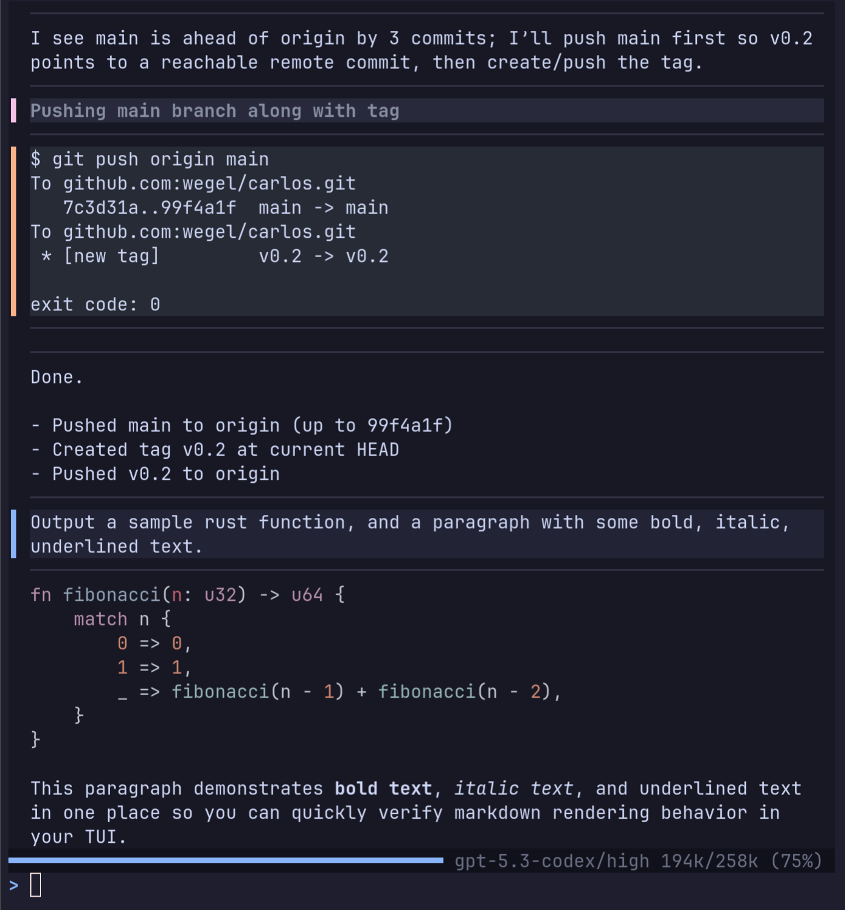

# carlos

Terminal frontend for `codex app-server`, the `claude` CLI, and `grok agent`.

[](docs/screenshot.png)

## status

Alpha.

## features

- start a new Codex thread with `carlos`
- start a new Claude session with `carlos --backend claude`
- start a new Grok session with `carlos --backend grok`
- resume Codex with `carlos resume <SESSION_ID>` or pick from `carlos resume`
- resume Claude with `carlos --backend claude resume <SESSION_ID>` or pick from `carlos --backend claude resume`
- resume Grok with `carlos --backend grok resume <SESSION_ID>` or pick from `carlos --backend grok resume`
- backend selection via `--backend <codex|claude|grok>` or `CARLOS_BACKEND=grok`
- local voice dictation (`Ctrl+D`), enabled in default builds, with Whisper profiles selected by `--dictation-profile <name>`
- runtime Ralph mode toggle (`Ctrl+R`) with:
  - prompt auto-injection from `.agents/ralph-prompt.md` (or `--ralph-prompt`)
  - blocked marker wait state (`@@BLOCKED@@` by default)
  - human approval gate marker (`@@AWAITING_HUMAN@@` by default), which exits Ralph
    instead of preserving a paused loop
  - completion marker detection + auto-exit from Ralph mode (`@@COMPLETE@@` by default)
  - configurable done, blocked, and human-gate markers
- multiline input with `Shift+Enter` / `Alt+Enter`
- shell-like input history navigation with `Up/Down`
- rewind mode for prompt replay/edit (`Esc,Esc` on empty input)
- turn interrupt while agent is running (`Esc`)
- markdown rendering and code syntax highlighting
- diff rendering with hunk-oriented display
- compact tool/action rows (`Read`, `Search`, `Edit`, `Diff`, `run ...`)
- Ctrl+M settings and `/tools auto|compact|full` control tool contents, with Auto hiding them on small terminals
- mouse scroll and drag selection with auto-copy on release
- OSC52 clipboard support for SSH sessions
- context usage indicator (`used/max (%)`) on the activity line
- Ralph mode visual indicators (`RALPH MODE` label, pink KITT/input gutter)
- context compaction markers in transcript
- native Codex waits and child-agent start/completion notices, including notices after the main answer
- dim, right-aligned session-name placeholder in the empty composer; `/rename [name]` edits the saved Codex or Claude name

## Tool output on small terminals

Carlos keeps the tool output it receives in memory and lets you choose how much
to show. Open Ctrl+M, select **Tool output**, use the arrow keys, and press Enter
to save. Escape cancels unsaved edits. You can also enter `/tools auto`,
`/tools compact`, or `/tools full`. A bare `/tools`
cycles through the three choices. These commands stay inside Carlos and never
send a message to the agent.

- `auto` is the default. Carlos folds tool contents below 80 columns or 20
  rows. It unfolds them once the terminal has at least 84 columns and 22 rows,
  so small resize changes do not repeatedly fold and unfold the transcript.
- `compact` replaces tool contents with summaries, including short command
  results, multiline scripts, reads, diffs, and failure details. Failed tools
  keep a `Failed:` label. Full mode reveals their details. Assistant answers
  and approval prompts remain visible.
- `full` shows all received tool output, even on a small terminal.

The Ctrl+M panel shows the chosen mode and, in Auto, the current view. Carlos
saves your explicit choice in `~/.config/carlos/ui-settings.json` (or under
`XDG_CONFIG_HOME` when set). Auto's temporary choice for a phone-sized terminal
does not change that saved preference. You can reveal earlier output without
rerunning a tool; reopened sessions use the contents available in the backend's
saved history.

## AI tool labels

Carlos shows its normal command label immediately, then asks a background worker
for a short description of selected commands. Open **Ctrl+M → AI labels** to turn
this on or off; it starts enabled. Nothing is added to the activity/status gauge.
You can also set `CARLOS_TOOL_SUMMARIES=off` before starting Carlos.
AI descriptions wrap across as many rows as needed, including in Compact mode;
the underlying commands and output stay folded there.

Carlos selects commands containing more than one actual line, inline
`-c`/`-e` programs with roughly 200 characters, named Python/shell/JavaScript scripts,
and command chains of at least 200 characters with multiple shell stages.
It keeps useful deterministic labels and ordinary short commands such as `cp`.
Quoted operators and terminal line wrapping do not make a command eligible.
Carlos also checks quoted SSH commands for substantial inline scripts or chains.
It summarizes their visible source without reading remote script paths locally.

Carlos hides a literal leading `cd /path &&` from command previews and AI-label
input. A different directory appears as `(in subdir)` beside the label. The
executed command, native history, approvals, and ordinary output stay unchanged.
Carlos keeps ambiguous shell prefixes intact, including expanded paths and
relative paths without a known command directory. A long directory alone never
makes a short command eligible for an AI label. Named scripts resolve from the
shown directory, while source reads stay inside the original workspace.

The default worker calls `gpt-6-luna` through the installed `codex` CLI and your
existing ChatGPT login. It uses the subscription allowance, with no separate API
key. It starts fresh ephemeral threads in a separate Codex home, disables shell
execution, and offers only bounded source-file reads and directory listings.
Luna can inspect a named script and local imports itself. Each request has a
45-second deadline, four source-tool calls, and a 64 KiB source budget. An invalid
label, timeout, unavailable login, or full queue leaves the original label intact.
Descriptions can still be wrong; the full command, output, and failure state stay
available in Full tool-output mode.

Carlos saves labels in `$XDG_STATE_HOME/carlos/tool-summaries.sqlite3`, normally
`~/.local/state/carlos/tool-summaries.sqlite3`. SQLite performs indexed lookups
with a bounded page cache; Carlos never loads the entire database. BLAKE3 hashes
the exact command text; filtered previews also include their directory, original
directory where Carlos may read source, and parser version in the key. The model
and prompt version are metadata, so changing them does not regenerate old labels. For file reads, Carlos also saves source
fingerprints and a per-entry link: new invocations validate source contents,
while resume restores the label originally generated for that entry. Historical
cache misses never trigger inference. File reads describe the source seen by the
worker, which may differ from the source present when a command began execution.

The separate home is `~/.local/state/carlos/summary-codex-home` by default. Carlos
initially links its `auth.json` to the existing Codex login and lets the official
CLI handle refreshes. If the dedicated login needs repair, sign in with
`CODEX_HOME=~/.local/state/carlos/summary-codex-home codex login`. Normal Codex
settings and sessions remain separate.

To change the model or executable, create `~/.config/carlos/tool-summaries.json`
(or use `$XDG_CONFIG_HOME/carlos/`) and restart Carlos:

```json
{"provider":"codex","model":"gpt-6-luna","executable":"codex","timeout_seconds":45}
```

A replaceable command adapter accepts one JSON object on stdin containing
`command`, `cwd`, and `instructions`, and returns one plain label on stdout:

```json
{"provider":"command","executable":"/absolute/path/to/summarizer","arguments":["--label"],"timeout_seconds":30}
```

Carlos passes arguments directly, without interpolating the command into a shell.
The adapter should describe input without executing it. Native Codex source tools
are implemented in Carlos itself; no Python runtime is needed for this feature.

## Transcript theme

Carlos uses the 3c Catppuccin Mocha theme on a shared Mantle background. User
messages have a darker blue band and bold text. Reasoning uses muted mauve in
italic, commentary uses pale pink, and answers use normal text with a green check.
Gutter blocks start with a colored glyph and a space; later lines keep a bar
in that color, except for answers. Flow blocks use colored section lines such
as `─ ❯ you ─` and `─ ✓ answer ─`. The body has one blank column
on each side and no vertical gutter. Adjacent entries of the same type share a
heading, with a blank line between entries; copied text leaves out those headings.
Each new block starts after a blank line, including blocks with horizontal headings.
Runs, reads, searches, diffs, and edits put their colored symbol beside the entry label
instead of using a horizontal heading. Reasoning that fits one row beside its
diamond uses the same style; longer reasoning keeps its heading.
Consecutive entries of these types form one block, with a blank line before and
after it, and no added blank lines inside it. An unfinished reasoning step uses
a mauve diamond and spinner.

Choose **Gutter** or **Flow** independently for **Desktop** and **Phone** in Ctrl+M.
Carlos uses the Phone choice below 80 columns or 20 rows and the Desktop choice
otherwise. Choose Flow for both to keep the section style at every size, or mix
the two themes. Both choices persist across restarts and stay independent of
the tool-output setting. Older global layout choices migrate automatically.

Literal tool labels occupy one row in Compact mode; AI descriptions wrap in full.
Their glyph replaces the verb: `$` for commands,
`→` for reads, `✱` for searches, and `Δ` for diffs and edits. Hidden-row counts
appear at the right, with green/red diff counts and a bold red `failed` label
when needed. Full mode still shows the original tool contents and syntax colors.
Both layouts keep consecutive tools and single-line reasoning together, with a
blank line around the block. Separate user messages, commentary, answers, and
longer reasoning have a blank line between them. Gutter keeps its colored
gutter and continuation bars. The K2000 scanner moves while Carlos works, using
a mauve light and fading violet trail, or pink in Ralph mode. On small screens
and in Flow, the light sweeps across the whole status line, including its text.
Text turns bold under the head. The separator is muted mauve and does not show
context usage. The percentage stays blue through 70%, yellow above 70%, and red
above 90%; token counts and the model name keep separate gray text.

For Codex accounts that report a weekly quota, the far right shows `W40%/2.1d`:
40% of the weekly allowance remains, and the quota resets in 2.1 days. The format
stays the same on every screen; Carlos shortens the model label first when space
runs out. The percentage is blue when the remaining allowance covers the fraction
of the week left, yellow when it covers at least three quarters of that fraction,
and red otherwise. An exhausted quota is always red. The countdown stays dim.
Carlos reads quotas asynchronously at startup and every five minutes, merges live
updates, and redraws the countdown each minute while idle. Missing or expired
weekly windows stay hidden until the server supplies current values. Carlos never
assumes that a quota has reset or that the account can send requests again.

## RTK commands

Carlos recognizes `rtk`, `rtk proxy`, `rtk bypass`, and `rtk run -c` when it builds
tool summaries, including global flags, nested wrappers, and quoted paths. It
labels native `rtk read`, `rtk smart`, search commands, tests, and builds by what
they do. Full mode keeps the RTK command and its flags, including complete command
chains when the backend provides them.

Single-file `rtk read` and wrapped `cat`, `head`, `tail`, `nl`, and print-only `sed`
commands get source colors even when the backend cannot identify the file. RTK's
numbered `│` gutters remain visible. Carlos leaves multiple-file and transformed
outputs as received.

RTK may shorten output before Carlos receives it. Full mode shows that received
text, including any saved-log references RTK prints. See the
[RTK README](https://github.com/rtk-ai/rtk/blob/master/README.md) for its command
filters and wrappers.

## Session names

When the composer is empty, Carlos shows the saved session name in gray on the
right. The name is only a placeholder: typing hides it, clearing your draft brings it back, and
pressing Enter on an empty composer does not send the name as a message.

For Codex sessions, enter `/rename New name` to save a name, or enter `/rename`
to load the current name into the composer for editing. Carlos saves the name
through Codex's app-server, without starting an agent turn. The name survives
restarting Carlos and appears in the native Codex session picker too. Carlos also
shows name changes sent by Codex while the session is open. Unnamed sessions keep
the empty composer.

## Shared Codex server and reconnect

`carlos --codex-socket /path/to/server.sock resume SESSION_ID` attaches to an
existing native Unix socket. Carlos opens only its local connection; it does not
start a daemon or change native login/config. Its exit leaves shared native work
running. The default `carlos` command still owns an installed Codex app-server.
Socket mode currently requires Unix; the native socket checks run on Linux.

Press F5 after a Codex connection fails. Carlos reads the current thread,
including a forked thread, and rebuilds history, model settings, queues, goals
and agent/process facts before allowing sends. You can keep typing while it
reads, and replayed questions stay answerable. Carlos keeps drafts and never
resends unconfirmed input or Ralph work. A resumed running turn keeps its exact
native turn ID. Resume hints retain the socket option.

Native Codex replays unanswered root requests on root reconnect. It does not
replay child requests through that root; F2 can inspect or stop a waiting child,
and another client already attached to that child can answer it. Carlos does
not resume children to create a hidden subscription. Verification-owner
ceremonies also do not replay. See [the client notes](docs/codex-client.md) for
bounds and partial-output behavior.

## Codex questions and approvals

Codex `F3` selects Steer or Queue for Enter. `/queue` or Alt+Q opens the native
queue: arrows select, e edits plain text, d deletes, s starts, and Alt+Up/Down
reorders. Ctrl+S saves an edit; Esc returns without replacing the main draft.
The activity line shows `Queue` while that mode changes Enter. Steer is the
default and stays quiet, with a brief notice when you switch back. `?` lists
F2/F3 and the other controls.
Codex stores queued messages and dispatches them after normal completion. An
interrupt leaves them queued. Carlos shows them in history only after native
Codex consumes them, and lets queued humans go before Ralph continues.

Ctrl+M applies model/effort/summary choices to future turns and, when supported,
later steps of the current turn. Carlos reports each result and keeps rejected
choices editable. Running requests retain their existing settings. Carlos uses
the native thread defaults for normal prompts and keeps its saved defaults
separate from native Codex config.

Codex `F2` opens agents and background processes. Arrows select a native row;
Enter reads that child's recent messages and tools, PageUp/PageDown scroll,
r reloads the latest window and l reads older records. x stops only the selected
agent's current turn or the selected process. F4 opens waiting questions; F2
closes the panel without changing drafts. Carlos keeps child output and child
report bodies out of the main transcript; the main agent's own report stays.
The activity line counts running agents/processes and requests needing attention;
old completed or idle rows do not keep a task badge visible. F2 shows errors
from unavailable process reads. Idle means no active work, not that the agent
completed its task. Missing resource
metrics say unavailable, and bounded/empty native history stays explicit.

Codex `/goal` or Alt+G opens native goals. e edits a separate objective/budget
draft; Tab moves fields and Ctrl+S saves. New goals start paused. a asks to
activate/resume, p pauses, and d asks to clear. Active changes need y confirmation
and may start Codex work immediately. Blank budget keeps an existing budget;
edits keep native counters. Carlos sends the observed status explicitly so a
concurrent clear cannot accidentally create an active goal. Native status,
tokens and time stay authoritative. Turn Ralph and any pending Ralph toggle off
before activating a goal; Carlos checks existing goals before enabling Ralph.
Ordinary chat and startup never create or change goals. Esc returns to the
overview with the draft kept, then closes; F5 remains reserved for reconnect.

Carlos shows questions and approvals from the main Codex thread and its children.
Each request keeps its own answer draft. F4 opens a waiting request or moves to
the next one. A nonblocking question leaves the main composer usable and shows
an F4 hint; a blocking request opens its editor. Child text and tool logs stay
outside the main conversation.

Tab changes fields, arrows/Space choose answers, and Ctrl+S sends. Alt+N skips a
question; Alt+C interrupts its requesting thread and turn. Esc returns to the
composer for nonblocking questions. Secret answers stay masked. Standard MCP
forms validate typed values before sending; URL requests require explicit
consent and never open a browser automatically. Unsupported forms can still be
declined or canceled. One-time human checkpoints never offer session approval.
See [the Codex client notes](docs/codex-client.md) for limits and reply behavior.

## Claude sessions, questions, and background work

Carlos runs the official Claude Agent SDK in a packaged helper. That helper starts
your installed native `claude` executable. Claude keeps its normal login,
subscription or configured provider, settings, plugins, and tool permissions.
Carlos does not need a separate API key, copy login credentials, or replace Claude
with a direct model client. Sign in through native Claude as usual.

Carlos shows native model choices and context counts, and applies model/effort
changes to the current process. It leaves omitted choices to native settings.
Context counts remain visible while Claude works. Carlos reads native summaries,
including cached input, without sending a model prompt or a token-count API call.
A `~` marks the last snapshot while Carlos waits for a fresh one; a real context
reset clears counts until native Claude reports them again.
Native permission requests, plans, AskUserQuestion choices, typed MCP forms, and
browser consent use their real request IDs. Each pending child keeps its own
answer draft. Replies return through native callbacks without another human
prompt. Unsupported forms can still be declined or cancelled.

Child text, thinking, tool calls, and tool results stay out of the main conversation,
including resumed history. F2 shows task details; child questions still ask for your
answer. The main assistant's own tools and reports remain visible.

- F2 opens native tasks and quota windows. Arrows select a task, x requests stop,
  and F2/Esc closes the panel. A stop acknowledgement says requested until Claude
  reports the task's outcome. Page Up/Down reveals details on small screens.
- F3 selects Enter behavior while Claude works: steer now or queue behind current
  work. The activity line shows `Queue` when selected and briefly shows `Steer`
  when you switch back. `?` lists the shortcuts; idle/completed tasks do not keep
  a task count visible. Interrupting the main turn may leave
  accepted queued prompts with Claude; Carlos reports those survivors.
- In a question, Tab changes fields, arrows/Space choose answers, and Ctrl+S sends.
  Alt+N declines, Alt+C cancels, F4 changes requests, and F10 interrupts main work.
  Ctrl+M still opens settings. The main composer and question caret stay separate.
- Native thinking appears in reasoning rows. Redacted-thinking token estimates
  show progress only. Context reads use native summary controls, never a new prompt.
- Native quota windows stay separate by time window and model. The shared weekly
  bucket uses the same remaining-percentage indicator as Codex. Missing or expired
  readings stay hidden; the optional experimental quota read cannot block a turn.

Human rows show `you (steer)` for prompts sent to steer running Claude work;
ordinary and queued prompts show `you`. Carlos saves that captured choice by
prompt UUID outside native session files, keeps it on resume, and carries it
through SDK forks. Older history without that fact stays plain; Carlos does not
guess from the text or the current mode. Claude steers remain editable by UUID.

`/rename` saves through the SDK. The picker and Continue read native CLI and SDK
sessions, including linked worktrees and custom `CLAUDE_CONFIG_DIR` folders.
Rewind forks before the selected human prompt and leaves the original intact.
Editing the first prompt starts an empty session. The activity line shows when
Carlos prepares the branch and sends the edit. A failed edit shows its reason
and keeps the saved text; F5 recovers retained drafts into an empty composer,
including when the original session is still ready. Later typing stays separate.
Carlos keeps older local human drafts for explicit recovery and drops queued
automatic work rather than replaying it onto the edited branch.
Automatic and child messages
are excluded from ordinary human rewind history. Older messages with unknown
sources remain labeled unknown; F4 in rewind explicitly selects one to branch.

Carlos reads older compacted history through the SDK's imported session cache.
A small read-only adapter follows pinned native compaction metadata. SDK upgrades
need the matching contract tests. History pages target 512 KiB; individual records
are capped at 16 MiB, imported caches at 256 MiB, and cumulative SDK reads at 512 MiB.
Carlos reports a limit failure instead of silently changing a fork's cut.

A native conversation reset clears the transcript once and adopts the next native
session ID. Unanswered callbacks, surviving background tasks, queued human UUIDs,
and unsent drafts keep their own lifetimes. A closed helper preserves unsent human
drafts; F5 loads a saved draft when the composer is empty. Failed turns stop Ralph
follow-ups. Ralph input remains automatic, including after session changes.

See [the helper guide](helpers/claude-controller/README.md) and
[local protocol](helpers/claude-controller/PROTOCOL.md) for developer details.

See [the native Codex client notes](docs/codex-client.md) for the current handshake,
paged history, compatibility limits and pipe failure behavior.

## Codex background monitors

When Codex is already working, a new message steers its current turn instead of
starting another turn. Carlos marks these user rows as `you (steer)`, or `steer`
on very narrow screens. The label stays out of copied text and model prompts.
Rewind can edit a turn's initial prompt, including one followed by steers. Codex
cannot edit a later steer independently: Carlos keeps your edited draft and the
conversation intact, shows an error, and creates no fork. Press Up to select an
earlier prompt, or Esc to cancel rewind.

Carlos uses the installed Codex app-server to run tools and child agents. Ask Codex
to monitor a task just as you would in the native Codex CLI. Carlos shows Codex's
waits and child-agent notices, and you can send another message while Codex waits.
An incoming message wakes Codex's interruptible `clock.sleep` tool. The same notices
remain visible when you reload the thread.

Codex can also launch an independent script through a shell or a remote process
manager. Such a script may keep running and writing logs, but Carlos cannot turn
those logs into agent messages by itself. Ask Codex to use its own child-agent or
wait tools when you need results in the conversation. Carlos does not add a timer
that sends prompts, create another agent turn when a child finishes, or promise
that a monitor will survive exiting Carlos.

## Ralph Loop Setup

If you want to run a repository in Ralph mode, this repo includes a generic starter bundle in
[`examples/ralph-loop/`](examples/ralph-loop/). That directory is laid out to mirror the root of
the target repository, so you can copy its contents verbatim into another repo and start from
there.

Copy the bundle into the target repo root with:

```bash
cp -r examples/ralph-loop/. /path/to/target-repo/
```

The bundle contains only files that belong at the target repo root or under `.agents/`:

- an example [`AGENTS.md`](examples/ralph-loop/AGENTS.md)
- an example [`PROGRAM_PLAN.md`](examples/ralph-loop/PROGRAM_PLAN.md)
- ExecPlan guidance in [`PLANS.md`](examples/ralph-loop/.agents/PLANS.md)
- a seed ExecPlan in [`EXECPLAN_001_example.md`](examples/ralph-loop/.agents/execplans/EXECPLAN_001_example.md)
- the Ralph prompt in [`ralph-prompt.md`](examples/ralph-loop/.agents/ralph-prompt.md)
- the current reviewer prompt directory: [`reviewers/`](examples/ralph-loop/.agents/reviewers/) with [`engineering_reviewer.md`](examples/ralph-loop/.agents/reviewers/engineering_reviewer.md)
- an empty `.agents/done/` directory placeholder for completed ExecPlans

The intended flow is:

1. Copy the contents of `examples/ralph-loop/` into the repository you want to automate.
2. Replace the example ExecPlan with a real one and update `PROGRAM_PLAN.md`.
3. Start `carlos` and press `Ctrl+R`, or launch with:

```bash
carlos --ralph-prompt .agents/ralph-prompt.md
```

`carlos` handles the continuation loop inside the TUI, watches for `@@BLOCKED@@` and
`@@COMPLETE@@`, and lets you answer blockers directly in the session.

## build

```bash
cargo build --release
python3 scripts/build-claude-controller.py
# Optional Rust build without local dictation:
cargo build --release --no-default-features
```

The helper build requires pinned Bun 1.3.10 and Python 3. It fetches the locked
SDK 0.3.322 packages at build time, checks them, and embeds the runtime. End users
need neither Node, Bun, npm, nor a package download. Native Claude remains a
separate installation. The helper disables runtime `.env`, bunfig, tsconfig,
and package.json loading, so project files cannot change the helper's process
environment or preload code. Explicit process environment and native settings
still apply.

The default `dictation` Cargo feature enables microphone capture, voice activity detection,
audio resampling, and local Whisper inference. Use `--no-default-features` to build without
audio or Whisper dependencies.

Linux builds with dictation need a C/C++ compiler, CMake, pkg-config, libclang, and
ALSA development headers. On Ubuntu, install `build-essential cmake pkg-config
libclang-dev libasound2-dev`.

## release packages and local install

Release archives contain `carlos`, `carlos-claude-controller`, their license
notices, a build manifest, checksums, and an optional helper relink bundle.
Windows uses `.exe` for both executables. Keep the pair together when unpacking;
you can put that directory on PATH. For a local Linux install, copy both as
regular executable files to `~/.local/bin/carlos` and
`~/.local/bin/carlos-claude-controller`. Keep the notices, relink folder, build
manifest, and checksums in the saved package folder. Back up existing executables
before replacing them. Copy the new pair to temporary files in `~/.local/bin`,
then rename the helper into place first and Carlos second.

The release workflow builds Linux x64, macOS Intel, macOS Apple Silicon, and
Windows x64 on matching native hosts. Each host runs package/runtime smoke checks
and native Claude startup/controls without inference. Linux also runs the full
terminal contracts against real native CLIs and localhost model fixtures. A
cross-compiled helper alone does not prove that its foreign platform works.
The default Linux build includes dictation and needs the usual ALSA/C++ system
libraries; Whisper models remain separate. The helper adds roughly 100 MiB on
Linux, 59–64 MiB on macOS, and 110 MiB on Windows before archive compression.

Build a fresh local package explicitly after the two executables are ready:

```sh
python3 scripts/package-release.py --target x86_64-unknown-linux-gnu \
  --binary target/release/carlos \
  --helper target/claude-controller/carlos-claude-controller \
  --output target/local-package --archive target/carlos-linux-x86_64.tar.gz
```

Carlos looks for `CARLOS_CLAUDE_CONTROLLER`, a helper beside its executable,
`../libexec/carlos/`, then the development target helper when running from
`target/debug` or `target/release`. These are paths to an already-built helper;
Carlos never downloads or builds one at launch. `CARLOS_CLAUDE_EXECUTABLE` can
select your native Claude executable explicitly; otherwise Carlos searches PATH.
Windows drive and UNC paths are supported. Native Windows users should use the
native `claude.exe` installation.

## dictation

Build with:

```bash
cargo build --release
```

Configure profiles in `~/.config/carlos/dictation.toml`:

```toml
default_profile = "fr-qc"

[profiles.fr-qc]
name = "French"
model = "~/.cache/carlos/ggml-large-v3-turbo-q5_0.bin"
language = "fr"
vocabulary = "~/.config/carlos/vocab-fr.txt"

[profiles.en]
name = "English"
model = "~/.cache/carlos/ggml-large-v3-turbo-q5_0.bin"
language = "en"
vocabulary = "~/.config/carlos/vocab-en.txt"
```

Vocabulary files are one term per line. Blank lines are ignored, and `#` starts a comment.
If a vocabulary file is missing or empty, Carlos uses a built-in technical vocabulary list.

Start with a specific profile:

```bash
carlos --dictation-profile en
```

Recommended whisper.cpp GGML models:

```bash
mkdir -p ~/.cache/carlos
curl -L -o ~/.cache/carlos/ggml-large-v3-turbo.bin \
  https://huggingface.co/ggerganov/whisper.cpp/resolve/main/ggml-large-v3-turbo.bin
curl -L -o ~/.cache/carlos/ggml-large-v3-turbo-q5_0.bin \
  https://huggingface.co/ggerganov/whisper.cpp/resolve/main/ggml-large-v3-turbo-q5_0.bin
```

Use `ggml-large-v3-turbo.bin` for best multilingual quality. Use
`ggml-large-v3-turbo-q5_0.bin` as the smaller CPU-friendly option. English-only `.en` models
are useful only if you dictate exclusively in English.

## run

```bash
cargo run
cargo run -- --backend claude
cargo run -- --backend grok
cargo run -- resume
cargo run -- resume <SESSION_ID>
cargo run -- --backend claude resume
cargo run -- --backend claude resume <SESSION_ID>
cargo run -- --backend grok resume
cargo run -- --backend grok resume <SESSION_ID>
cargo run -- --ralph-prompt .agents/ralph-prompt.md
```

## test

Run `bash scripts/test.sh` for the Rust suite and terminal workflow tests. The
runner installs its pinned Python test packages into `target/ui-venv`, then starts
the real Carlos executable in a terminal and sends keys and pasted text. Local
Codex and Claude peers supply fixed responses, so the tests need no account or model.

The tests cover editing the first or a later message, repeated edits, canceling
an edit, fork/send failures, older servers, paginated history, streaming, resize,
resume, saved session names, replayed starts, and Claude interrupts. They check the screen and backend
messages. Screens, keystrokes, raw terminal bytes, and requests/responses remain
under `target/ui-artifacts/`.
CI runs these checks plus public Codex and native Claude checks on every push
and pull request. The native Claude contracts currently test 2.1.322.

Use `bash scripts/test.sh --release --codex-contract --claude-contract` before
installing a release that changes either backend. Release mode also runs strict
Clippy and the optimized Rust tests. The extra checks call the installed Codex server
against a generated session in a temporary Codex home. They also drive Carlos
through native Codex waits and child-agent completion after the parent answers,
then reload the thread. A local HTTP peer supplies fixed model replies; these
checks need no account, paid inference, or access to user sessions. The runner
saves both the app-server traffic and local model requests with the screen captures.
The Claude contracts stage a colocated Rust/helper pair outside development
fallback paths, use the installed unmodified CLI with isolated fake credentials,
and send every model request to a localhost fixture. They cover native sessions,
questions/plans, background completion/stop, and queued input across clear.
Package checks also run from a hostile folder with Node/Bun absent from PATH.
No normal test uses the user's account or needs paid inference.

To test an installed executable directly:

```bash
target/ui-venv/bin/python tests/ui/test_workflows.py --binary ~/.local/bin/carlos -v
```

## controls

- `Enter`: send message, or stop recording while dictating
- `/rename [name]`: change the Codex or Claude session name, or load the current name to edit
- Codex `F3`: choose Steer or Queue for Enter; Alt+Q or `/queue` opens the queue
- Codex queue arrows/e/d/s: select/edit/delete/start; Alt+Up/Down reorders, Ctrl+S saves edits
- Codex question `F4`: open or change pending requests; Tab/arrows/Space edit, Ctrl+S sends
- Codex question `Alt+N`: skip; Alt+C interrupts its requesting turn; Esc hides a nonblocking question
- Claude `F2`: native tasks/quotas; arrows select, x requests task stop
- Claude `F3`: choose steer or queue for Enter while Claude works
- Claude question `Tab`/arrows/Space: edit answers; Ctrl+S sends, Alt+N declines, Alt+C cancels
- Claude question `F4`: next pending request; F10 interrupts main work
- Claude rewind `F4`: explicitly choose older unknown-source records
- Claude `F5`: recover a retained human draft into an empty composer
- `/tools [auto|compact|full]`: choose how much tool output to show; omit the mode to cycle
- `Shift+Enter` / `Alt+Enter`: newline in input
- `Up/Down`: input history navigation
- `Esc` (while turn active): interrupt running turn
- `Esc,Esc` (idle + input non-empty): clear input
- `Esc,Esc` (idle + input empty): enter rewind mode
- After an interrupt, wait 700 ms without pressing `Esc` before starting either shortcut.
- rewind mode `Up/Down`: select prior user prompts (also repositions transcript)
- rewind mode `Enter`: send selected/edited prompt
- rewind mode `Esc`: leave rewind mode and restore current draft
- `Ctrl+R`: toggle Ralph mode on/off (queued if a turn is currently active)
- `Ctrl+M`: open settings for model, thinking, summary, AI labels, dictation, desktop/phone themes, and tool output
- Ctrl+M's `Context` row accepts `Auto`, a token count such as `500000`, or a size such as `500k` or `1M` (100k–1M). Left/Right cycles presets; Enter saves; Esc cancels. Carlos saves a separate choice for Claude and Codex.
- Restart Carlos to apply a changed context size. Claude uses it to choose when to summarize older messages, reserving room for the summary. Codex uses it as the window size and summarizes at 90% of that size. Each backend still enforces its model's maximum. `Auto` inherits the native CLI's settings.
- An attached Codex server keeps its owner's context settings. A `CLAUDE_CODE_AUTO_COMPACT_WINDOW` shell override takes precedence over Claude's setting; Carlos reports it instead of saving an ignored choice.
- `Ctrl+D`: start/stop dictation when the `dictation` feature is enabled
- `F7`: cycle dictation profile when the `dictation` feature is enabled
- `F9`: toggle dictation endpoint mode between auto-stop and manual Enter stop
- `Ctrl+Y`: copy selection or last assistant message
- `Ctrl+L`: clear selection
- `PageUp/PageDown`: transcript scroll
- `Home/End`: jump top/bottom (empty input)
- `F6`: invert scroll direction
- `F8` or `Ctrl+P`: toggle perf overlay (or set `CARLOS_METRICS=1` at startup)
- mouse wheel: scroll
- left drag: select
- left release: copy selection
- `Ctrl+C`: quit

## notes

- SSH clipboard uses OSC52
- currently tested mainly on Linux terminals
- optional perf overlay/report: `CARLOS_METRICS=1`
- Claude backend requires the `claude` CLI to be installed and available on `PATH`
